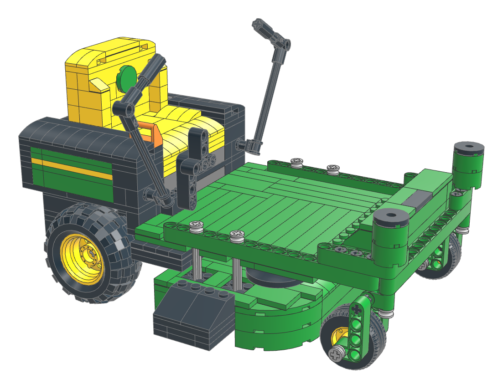
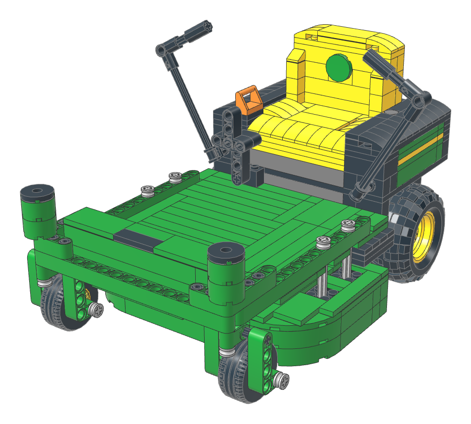
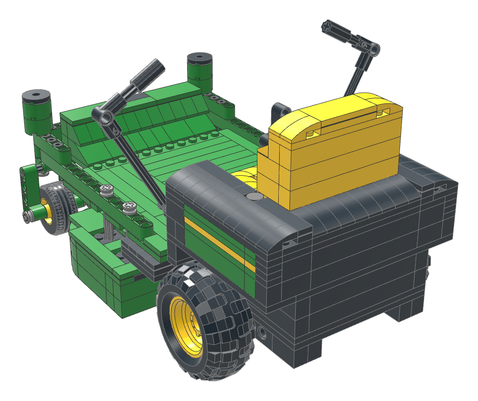
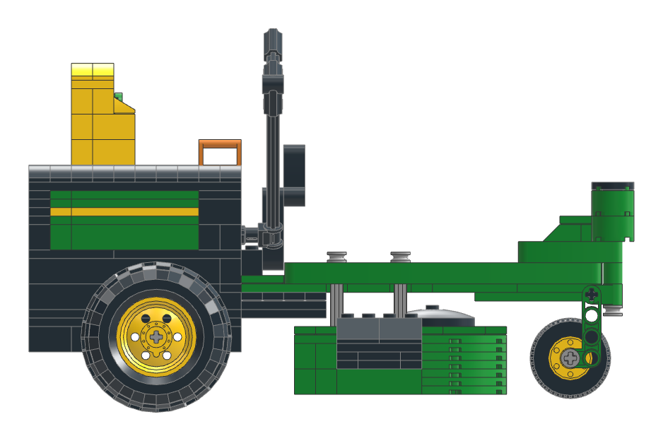
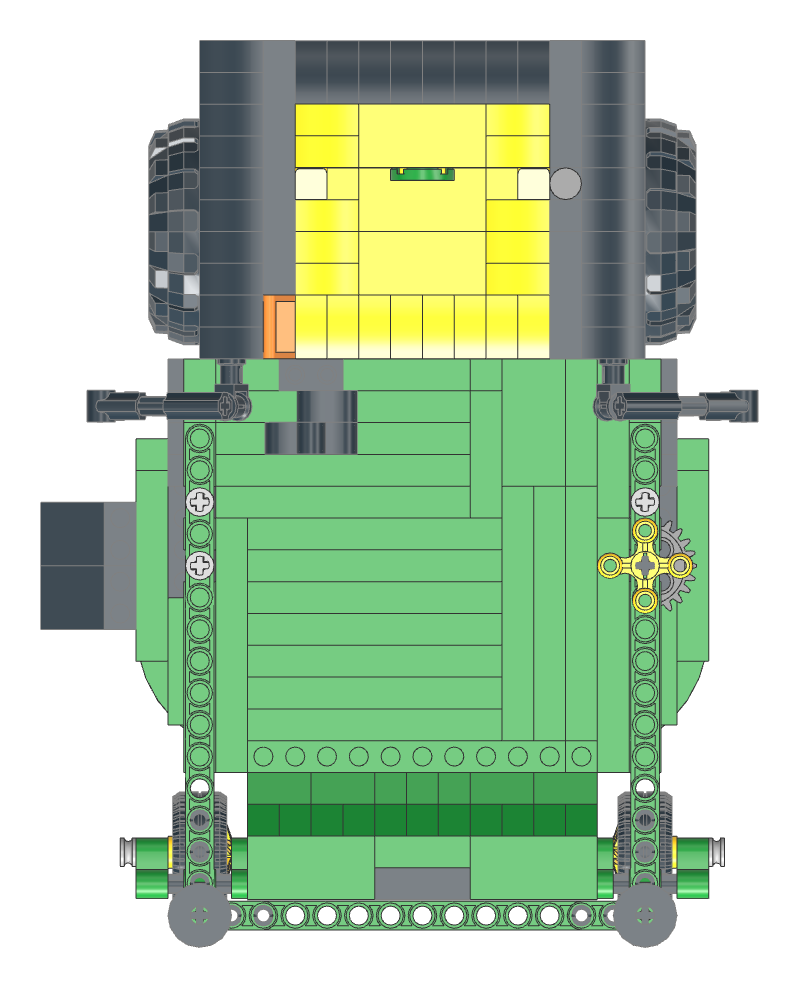
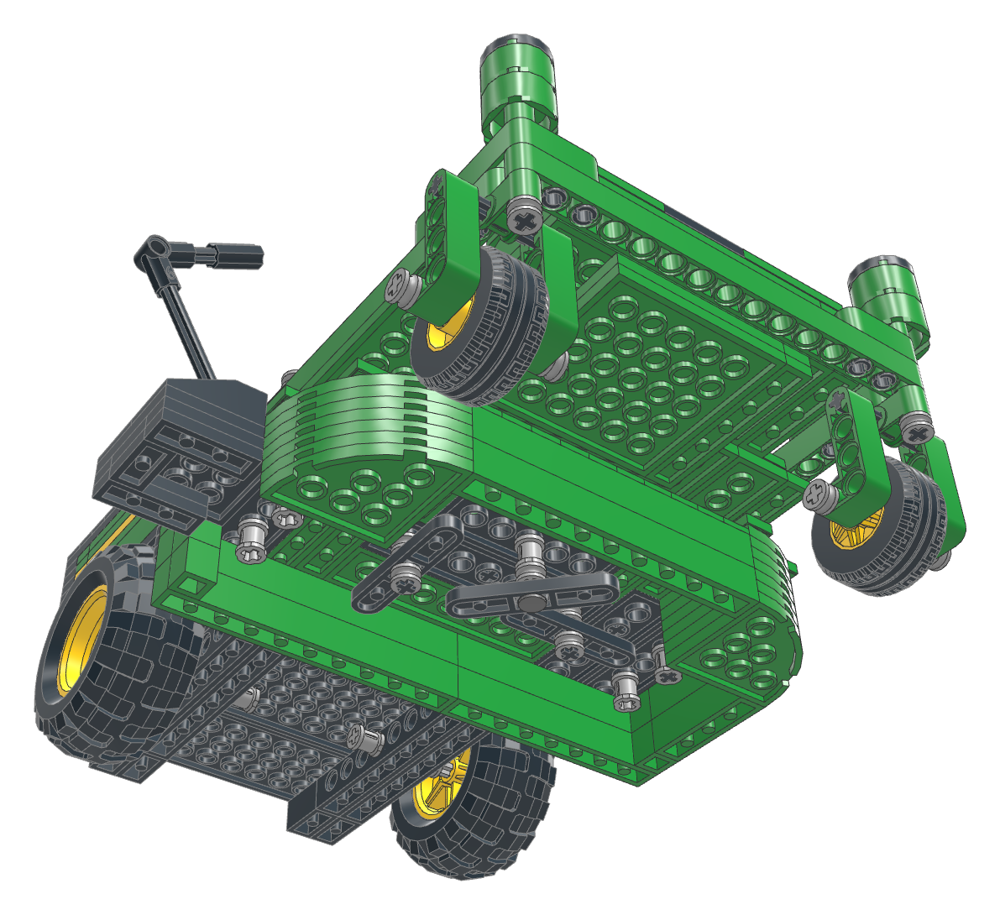
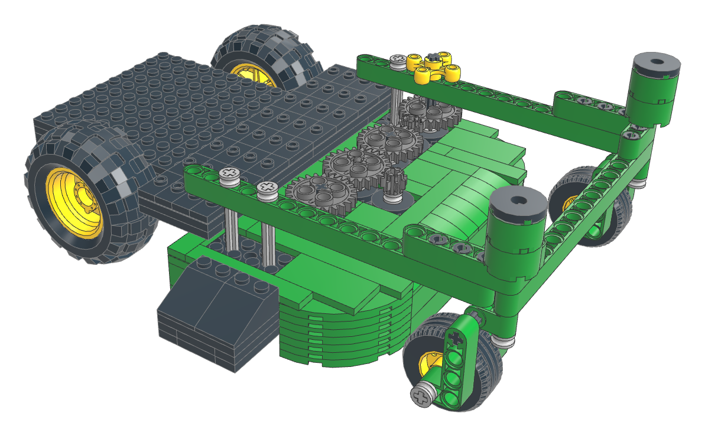

# John Deere Z315E ZTrak i LEGO

En byggbar LEGO-modell av nollsvängsklipparen John Deere Z315E med 42-tums klippaggregat, i skala 1:8. Chassi, länkhjul, klippaggregatets upphängning och styrspakar är byggda med Technic. Kaross, säte och klippaggregatets skal är byggda med vanliga klossar, på samma sätt som i LEGOs egna John Deere-set.



| | |
|---|---|
| Skala | 1:8 (bakdäck 56 mm = 18" i verkligheten, framhjul 30 mm) |
| Antal delar | 485 (116 olika del/färg-kombinationer) |
| Mått | ca 23 × 18 × 14 cm (L × B × H) |
| Färger | grön, gul, svart, mörk och ljus blågrå, en orange detalj |
| Filformat | LDraw MPD (öppnas i BrickLink Studio, LeoCAD eller LDCad), GLB och STL |

## Funktioner

- Framhjulen är länkhjul som svänger fritt 360°. Gaffeln har efterföljning, så hjulen ställer in sig själva när modellen rullas.
- Bakhjulen sitter på var sin axel och rullar oberoende av varandra. Modellen kan därför snurra på stället, precis som en riktig zero-turn.
- Styrspakarna (lap bars) är ledade och kan fällas ut i parkeringsläge, som på fotot, eller fällas in i körläge.
- Klippaggregatet hänger i fyra stänger under ramen, som på originalet, och har rundade framhörn och utkastartrumma på höger sida.
- Under klippaggregatet sitter tre knivar som snurrar. Vrid på den gula knoppen ovanpå vänster sidobalk så snurrar alla tre. Kraften går via kugghjul ovanpå klippaggregatet, där originalet har remmen och remskivorna. Mittkniven sitter längre fram och lägre än de andra, så knivarna kan inte slå i varandra.
- Fotstöd med John Deere-skylt, lyftpedal för klippaggregatet och tankkåpa.

## Bygga modellen

1. **Bygginstruktion:** [`docs/bygginstruktioner.pdf`](docs/bygginstruktioner.pdf) har 80 sidor A4 liggande. Den börjar med alla delar och deras Pick a Brick-nummer och har sedan 74 byggsteg i samma ordning som 3D-visaren. Delar från tidigare steg är ljusare, röda pilar visar delar som inte sätts ovanifrån och delmonteringarna har grön ram.
2. **Studio-instruktioner:** öppna [`model/z315e.mpd`](model/z315e.mpd) i [BrickLink Studio](https://www.bricklink.com/v3/studio/download.page) (gratis). Främre ramen, klippaggregatet, karossen och sätet är delmonteringar som byggs för sig och sätts på plats färdiga. Bakram, drivhjul, golv, länkhjul, upphängning och styrspakar byggs direkt på modellen. Studios instruktionsläge gör en utskrivbar PDF av stegen.
3. **3D-visare:** `viewer/index.html` visar modellen steg för steg med dellista för varje steg. Varje del kommer in från ett håll där den inte krockar med det som redan är byggt, och delmonteringarna byggs för sig innan de åker in på plats. När delar sätts underifrån vänds vyn så att man ser undersidan. Visaren är en statisk webbsida, alltså tre filer utan serverdel, och kan läggas på vilken webbserver som helst. Den måste öppnas via http och inte direkt som fil från disken. Lokalt räcker `python3 -m http.server` i `viewer/`. Arbetsflödet `.github/workflows/pages.yml` publicerar den på GitHub Pages, https://henrikljungberg5467.github.io/lego/, varje gång `viewer/` ändras. Den publiceras även som Claude-artefakt.
4. **Köpa delar:**
   - BrickLink: ladda upp [`docs/bricklink_wanted.xml`](docs/bricklink_wanted.xml) under *Want → Upload*.
   - LEGO Pick a Brick: ladda upp [`docs/pick_a_brick.csv`](docs/pick_a_brick.csv) (elementId, quantity, 115 rader). Elementen är kontrollerade mot Pick a Brick i oktober 2026, utom de sex som kom till med knivarna: 24-kuggshjulet, 8-kuggshjulet, knivarna, knoppen, axeln med stopp och Technic-plattan 2 × 8. Det enda som saknas där är de två bakdäcken, som köps på BrickLink med [`docs/bricklink_inte_pa_pab.xml`](docs/bricklink_inte_pa_pab.xml). Vad som byttes ut för att allt annat skulle finnas på Pick a Brick står i [`docs/inte_pa_pick_a_brick.md`](docs/inte_pa_pick_a_brick.md).
   - Rebrickable: importera [`docs/parts.csv`](docs/parts.csv) (Part, Color, Quantity). Därifrån kan listan skickas vidare till BrickLink eller LEGO Pick a Brick.
   - Hela listan med svenska färgnamn finns i [`docs/parts.md`](docs/parts.md).

3D-filer: [`docs/z315e.glb`](docs/z315e.glb) har färger, en nod per del och verklig storlek. Den öppnas i till exempel Blender, Windows 3D-visare eller en webbläsarbaserad glTF-visare. [`docs/z315e.stl`](docs/z315e.stl) är hela modellen som ett enda nät i millimeter, utan färger. Den passar för rendering och CAD men går inte att 3D-skriva ut som den är, eftersom den består av 485 separata delar.

Den enda ovanligare delen är den gröna Technic-balken 1 × 15 (32278). Den har funnits i sex set, bland annat LEGO 42157 John Deere 948L-II, och finns på Pick a Brick.

## Hur modellen är kontrollerad

Modellen är inte provbyggd fysiskt än, men den har kontrollerats digitalt med verktygen i `tools/`:

- **Delar och färger:** varje del/färg-kombination har slagits upp i Rebrickables lagerdata. Alla förekommer i officiella LEGO-set, och de automatiskt utlagda plattorna och klossarna använder bara kombinationer som funnits i minst tre set.
- **Anslutningar:** alla stift, axlar, hål och knoppar matchas mot anslutningsdata från LDCad Shadow Library. Alla 485 delar hänger ihop i en enda struktur, och inga stift sitter i fel sorts hål. Knivarnas axlar går i runda hål, så de kan snurra fritt.
- **Kollisioner:** varje del voxeliseras med 1 LDU (0,4 mm) upplösning. Inga delar går in i varandra.
- **Byggordning:** för varje del, och för varje delmontering när den monteras, kontrolleras att den har en fri väg in förbi det som redan är byggt: uppifrån, nedifrån eller från sidan.
- **Kugghjul:** alla kugghjul sitter på LEGOs standardavstånd (24 + 24 kuggar: 3 knoppar, 24 + 8 kuggar: 2 knoppar) och är vridna så att tänderna går i varandra utan att krocka.

Saker som är förenklade jämfört med originalet:

- Dekalerna ingår inte som LEGO-delar. [`stickers/z315e_stickers.svg`](stickers/z315e_stickers.svg) är ett ark i skala 1:1 med "JOHN DEERE", "Z315E" och varningsetiketter, som kan skrivas ut på klisteretikettpapper. Hjortlogotyperna är inte med; den gröna runda brickan på sätet sitter där logotypen ska vara.
- Den gula randen på sidopanelen är rak. På originalet lutar den.
- Klippaggregatet sitter på fast höjd. Lyftpedalen är bara en detalj.
- Originalets 42-tumsaggregat har två knivar. Modellen har tre.

## Struktur

```
model/z315e.py        generator: hela modellen beskriven i Python (koordinater i LDU)
model/z315e.mpd       den genererade LDraw-modellen
docs/                 dellistor (Pick a Brick, BrickLink, Rebrickable, Markdown)
stickers/             dekalark att skriva ut
renders/              renderingar
viewer/               3D-visare med byggsteg (three.js + LDrawLoader)
tools/check.py        kontroll av anslutningar, kollisioner och färger
tools/render.mjs      rendering i headless Chromium
tools/partlist.py     dellistor
tools/buildplan.py    byggordning och fri väg in för varje del (används av visaren)
tools/build_viewer.py packar modellen med alla LDraw-delar för visaren
tools/instructions.py bygginstruktionen som PDF (bilder via instructions.mjs/.html)
tools/export3d.mjs    GLB- och STL-export
```

### Generera om

Verktygen behöver LDraw-biblioteket, [LDCad Shadow Library](https://github.com/RolandMelkert/LDCadShadowLibrary) och Rebrickables databas. Den sista finns som SQLite i npm-paketet `lego-oracle`. Rebrickables elementtabell (för Pick a Brick-numren) finns som parquet i [kiliantscherny/Fun-With-LEGO-data](https://github.com/kiliantscherny/Fun-With-LEGO-data). Sökvägarna anges med `LDRAW_LIB`, `LDCAD_SHADOW`, `REBRICKABLE_DB` och `REBRICKABLE_ELEMENTS`.

```sh
npm install                                   # three.js + playwright
python3 model/z315e.py                        # skriver model/z315e.mpd
python3 tools/check.py model/z315e.mpd        # anslutningar, kollisioner, färger
python3 tools/partlist.py model/z315e.mpd docs
tools/views.sh model/z315e.mpd tmp/view       # granskningsbilder
python3 tools/build_viewer.py
python3 tools/instructions.py                 # docs/bygginstruktioner.pdf
node tools/export3d.mjs docs/z315e.glb docs/z315e.stl
```

## Fler vyer

| | |
|---|---|
|  |  |
|  |  |
|  |  |

LDraw-delarna i `viewer/z315e_packed.mpd` kommer från LDraw.org-biblioteket (CC BY 4.0).

John Deere och ZTrak är varumärken som tillhör Deere & Company. LEGO är ett varumärke som tillhör LEGO Group. Det här är ett fristående hobbyprojekt.
